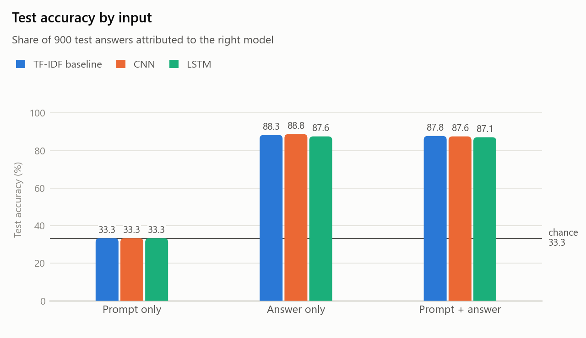
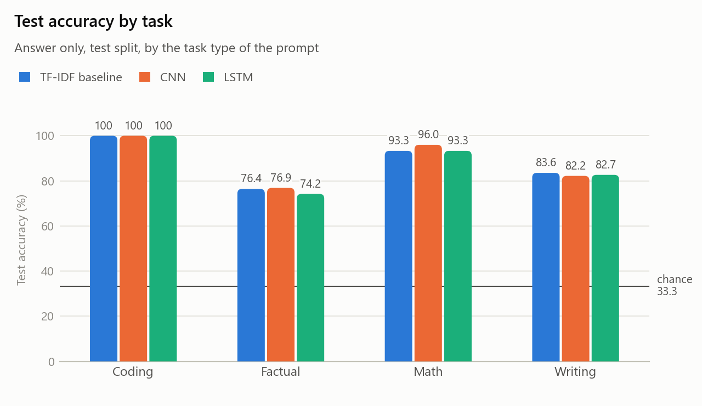

# Technical note: the CNN and LSTM classifiers

This note describes the two neural classifiers in `src/models.py`, how `src/train.py` trains them, how their settings were chosen, and what they score. The dataset is described separately in `technical_report.md`. All numbers were produced on 10 October 2026 and can be regenerated with the commands in section 9.

## 1. Summary

The task is to name which of three LLMs (`llama3.1:8b`, `mistral:7b`, `qwen2.5:7b`) wrote a text. With three balanced classes, guessing gives 33.3%.

Accuracy on the 900 test rows:

| Classifier | Prompt only | Answer only | Prompt + answer |
| --- | --- | --- | --- |
| TF-IDF + logistic regression (baseline) | 33.3% | 88.3% | 87.8% |
| CNN | 33.3% | 88.8% | 87.6% |
| LSTM | 33.3% | 87.6% | 87.1% |

- **All three classifiers identify the model from its answer about 88% of the time.** They differ by about one point, which is less than the two-point spread between runs of one model with different random seeds (section 6). No classifier can be called better than another on this evidence.
- **The prompt alone gives exactly chance,** and adding the prompt to the answer does not help (section 7).
- **The CNN trains in about 10 seconds and the LSTM in about 90** on an RTX 5090.



## 2. From text to tensors (`src/data.py`)

| Step | What is done |
| --- | --- |
| Tokens | Text is lower-cased. A token is a word, or one punctuation or markdown character (`\w+|[^\w\s]`). The baseline uses the same rule. |
| Vocabulary | Built from the training split only. A token seen fewer than twice becomes `<unk>`. Three special tokens: `<pad>` (id 0), `<unk>`, `<sep>`. |
| Length | A text is cut to its first 512 tokens. |
| Batches | 32 texts, padded with `<pad>` to the longest text in the batch. The true length of each text is passed along. |
| Labels | The index of the model's name in the sorted list of the three names. |

Figures for the answer-only input:

| | Value |
| --- | --- |
| Vocabulary | 19,928 tokens |
| Tokens per training text | median 293, 90th percentile 568, longest 680 |
| Training texts longer than 512 tokens (cut) | 15.7% |
| Validation tokens not in the vocabulary | 3.7% |

The three inputs of RQ2 are selected with `mode`: `answer`, `prompt`, or `both`. For `both`, the prompt (at most 170 tokens), a `<sep>` token and the answer are joined and cut to 512 tokens.

## 3. The models (`src/models.py`)

Both models take a batch of token ids and the true lengths, and return three scores per text. The largest score is the prediction.

### CNN

| Layer | Output shape for one text of T tokens | Parameters |
| --- | --- | --- |
| Embedding, 128 dimensions | T × 128 | 2,550,784 |
| Four 1-D convolutions in parallel, widths 2, 3, 4, 5, 128 filters each, ReLU | (T − k + 1) × 128 for each width k | 229,888 |
| Maximum over time of each filter | 4 × 128 = 512 | 0 |
| Dropout 0.5 | 512 | 0 |
| Linear | 3 | 1,539 |
| Total | | 2,782,211 |

A filter of width k looks at k neighbouring tokens, so it learns to respond to one kind of k-token pattern, such as `* *` followed by a capitalised word. Taking the maximum over all positions asks whether that pattern occurs anywhere in the text. The result does not depend on where the pattern is or on how long the text is.

### LSTM

| Layer | Output shape for one text of T tokens | Parameters |
| --- | --- | --- |
| Embedding, 128 dimensions, then dropout 0.5 | T × 128 | 2,550,784 |
| One bidirectional LSTM layer, 256 units per direction | T × 512 | 790,528 |
| Maximum over time of each output dimension | 512 | 0 |
| Dropout 0.5 | 512 | 0 |
| Linear | 3 | 1,539 |
| Total | | 3,342,851 |

An LSTM reads the tokens in order and carries a memory from one token to the next, so its output at a position depends on everything read so far. Reading in both directions gives each position the context before and after it. The sequence is packed before it enters the LSTM, so the LSTM stops at each text's true end and does not run over padding.

### Padding is excluded from the pooling

In both models, positions that belong to padding are masked before the maximum is taken. The prediction for a text therefore does not change with the length of the other texts in its batch.

## 4. Training (`src/train.py`)

| Setting | Value |
| --- | --- |
| Loss | Cross-entropy on the three scores |
| Optimiser | Adam, learning rate 0.001 |
| Batch size | 32, shuffled each epoch |
| Gradient clipping | Norm limited to 5 |
| Epochs | At most 20 |
| Model selection | After each epoch the model is scored on the validation split. The weights of the epoch with the best validation accuracy are kept; lower validation loss breaks a tie. |
| Early stopping | Training stops after 3 epochs without a better validation accuracy |
| Random seed | 448 |
| Test split | Read once per run, after training, with the kept weights |

Every run writes its settings to `results/runs/<run>/config.json` and its per-epoch numbers to `history.json`.

### The final runs

| Run | Parameters | Epochs run | Kept epoch | Time | Validation accuracy | Test accuracy | Test macro F1 |
| --- | --- | --- | --- | --- | --- | --- | --- |
| `cnn_answer` | 2,782,211 | 9 | 6 | 6.7 s | 89.8% | 88.8% | 0.888 |
| `cnn_prompt` | 1,379,843 | 12 | 9 | 8.4 s | 33.3% | 33.3% | 0.283 |
| `cnn_both` | 2,876,931 | 15 | 12 | 9.8 s | 89.0% | 87.6% | 0.876 |
| `lstm_answer` | 3,342,851 | 14 | 11 | 90.9 s | 88.7% | 87.6% | 0.876 |
| `lstm_prompt` | 1,940,483 | 5 | 2 | 24.7 s | 33.3% | 33.3% | 0.215 |
| `lstm_both` | 3,437,571 | 14 | 11 | 87.3 s | 88.4% | 87.1% | 0.872 |

The parameter counts differ between inputs because the vocabulary does (8,972 tokens for prompts, 20,668 for prompt + answer).

### How training went


- **The CNN learns fast and then overfits.** Its validation accuracy peaks at epoch 6 (89.8%). After that the training loss keeps falling (0.29 to 0.20) while the validation loss rises (0.273 to 0.295), so later epochs only memorise the training set. Early stopping keeps epoch 6.
- **The LSTM learns more slowly.** Its validation accuracy climbs from 74.3% in epoch 1 to 88.7% in epoch 11.
- **Validation accuracy is above training accuracy in the first epochs.** This is expected: dropout is switched on while training and off while validating, and the training figure is an average over an epoch during which the model is still improving.

## 5. Checks made on the code

| Check | Result |
| --- | --- |
| Can each model memorise 50 training rows? (`train.py --overfit 50`) | Yes: both reach 100% on those rows with dropout off. A model that could not would have a bug. |
| Does a prompt-only model stay at chance? | Yes: exactly 33.3% for both, as the data design requires (section 7). |
| Is the same scoring used for every classifier? | Yes: the baseline and both models are scored by `evaluate.score`. |
| Does the saved accuracy match the saved predictions? | Yes: recomputed from `predictions_test.jsonl`. |

One defect was found and fixed before the final runs. The first version of the training loop compared a rounded validation accuracy with an unrounded one, so an epoch that tied the best one could wrongly count as an improvement. In the prompt-only run, where every epoch scores 33.3%, this kept training going for all 20 epochs. After the fix, all training runs and all tuning trials were run again; every number in this note comes from the corrected code.

## 6. How the settings were chosen (`src/tune.py`)

Each trial changes one thing about a starting point and is scored on the **validation** split only. The test split is not read. The starting point is: embedding 128, dropout 0.5, learning rate 0.001, batch 32, 512 tokens; CNN with 128 filters of widths 2 to 5; LSTM with one bidirectional layer of 128 units and maximum over time.

| CNN trial | Validation accuracy | | LSTM trial | Validation accuracy |
| --- | --- | --- | --- | --- |
| Starting point | 89.9% | | Starting point | 86.9% |
| 700 tokens | 89.4% | | Last memory instead of maximum over time | 85.7% |
| Widths 1 to 5 | 88.9% | | 700 tokens | 84.6% |
| Widths 3 to 5 | 89.7% | | **256 units** | **88.7%** |
| 256 filters | 89.8% | | 2 layers | 87.8% |
| Embedding 256 | 89.3% | | Dropout 0.3 | 87.2% |
| Dropout 0.3 | 89.9% | | Learning rate 0.002 | 87.9% |
| Learning rate 0.0005 | 90.2% | | Embedding 256 | 86.3% |
| Batch 64 | 89.1% | | Patience 5 | 87.6% |

The chosen settings were then repeated with three other random seeds:

| Seed | CNN (starting point) | LSTM (256 units) |
| --- | --- | --- |
| 448 | 89.9% | 88.7% |
| 1 | 88.0% | 86.8% |
| 2 | 88.3% | 88.7% |
| 3 | 89.1% | 87.4% |
| Spread | 1.9 points | 1.9 points |

**Decisions**

- **CNN: the starting point was kept.** No variation changed validation accuracy by more than one point, which is inside the spread between seeds.
- **LSTM: 256 units and maximum over time.** 256 units scored 1.8 points above 128, and maximum over time scored 1.2 points above the last memory. Both gaps are about the size of the spread between seeds, so they are plausible improvements, not established ones. Maximum over time also has a reason behind it: over several hundred tokens the final memory has to carry everything, while the maximum can pick up a signal from any position.

All 24 trials are in `results/tuning.jsonl`.

## 7. Results

### RQ1: can the LLM be identified from its answer?

Yes. All three classifiers reach about 88% on the test split, against 33.3% for guessing.

**By model, test split, answer only (precision / recall):**

| Model | Baseline | CNN | LSTM |
| --- | --- | --- | --- |
| `llama3.1:8b` | 0.90 / 0.86 | 0.89 / 0.89 | 0.87 / 0.89 |
| `mistral:7b` | 0.80 / 0.95 | 0.83 / 0.93 | 0.85 / 0.88 |
| `qwen2.5:7b` | 0.98 / 0.83 | 0.96 / 0.85 | 0.91 / 0.86 |


- **Mistral is the class the others are mistaken for.** Its recall is high and its precision low: most errors are Llama or Qwen answers labelled Mistral.
- **Qwen is the reverse.** When a classifier says Qwen it is almost always right, but about 15% of Qwen's answers are given to another model.
- **A possible reason, not tested:** Mistral writes plain text with little markup, while Qwen and Llama often use headings, bold and lists (see `technical_report.md`, section 5). An answer without distinctive formatting would then look most like Mistral.

**By task, test split, answer only:**

| Task | Baseline | CNN | LSTM |
| --- | --- | --- | --- |
| Coding | 100% | 100% | 100% |
| Math | 93.3% | 96.0% | 93.3% |
| Writing | 83.6% | 82.2% | 82.7% |
| Factual | 76.4% | 76.9% | 74.2% |



Code reviews are identified perfectly and short factual answers are hardest, for every classifier.

**Do the two neural models make the same mistakes?** Mostly. On the 900 test rows they give the same prediction for 815. Both are right on 757 and both are wrong on 70; the CNN alone is right on 42 and the LSTM alone on 31.

### RQ2: does the prompt help?

No.

- **The prompt alone scores exactly 33.3%** for the baseline, the CNN and the LSTM. This follows from how the dataset was built: every prompt was sent to all three models, so the same prompt text appears three times with three different labels. Whatever a classifier predicts for that text is right for one of the three rows and wrong for the other two.
- **Adding the prompt to the answer changes little** (88.8% to 87.6% for the CNN, 87.6% to 87.1% for the LSTM), and never upwards. The prompt carries no information about the model and takes up part of the 512 tokens.
- **A prompt-only score above chance would therefore signal a flaw,** such as a split that puts the same prompt in training and test, or a dataset in which different models received different prompts.

## 8. Limits

- **One run per configuration on the test split.** The seed comparison used validation only, so there is no measured spread for the test numbers.
- **Differences of a point or two are not meaningful.** One point is 9 of the 900 test rows. A rough 95% interval around 88% is ±2 points, and the rows are not independent, because each prompt contributes three of them.
- **Small results differences between GPU runs.** Repeating the CNN run with the same seed moved test accuracy by 0.1 point.
- **Texts are cut at 512 tokens,** which affects 15.7% of the training texts. Using 700 tokens did not help on validation.
- **Embeddings are learned from scratch** on 4,194 training texts. Pretrained embeddings were not tried.
- **The neural models do not beat the baseline.** A likely reason, not tested, is that the signal is mostly in which words and symbols occur, which TF-IDF captures directly, and that the training set is small.
- **RQ3 and RQ4 are outside this note.** They were run afterwards; their results are in the report (`report/report_draft.md`).

## 9. Reproducing the numbers

```bash
python src/tune.py
```

```bash
python src/train.py --model cnn
```

```bash
python src/train.py --model lstm
```

```bash
python src/evaluate.py
```

```bash
python src/plot_results.py
```

Add `--mode prompt` or `--mode both` to `train.py` for the other inputs of RQ2. `tune.py` takes about half an hour; everything else takes under two minutes per command.

## 10. Files

| File | Contents |
| --- | --- |
| `src/models.py` | `TextCNN` and `LSTMClassifier` |
| `src/train.py` | The training loop, early stopping, and the options for RQ2 and RQ3 |
| `src/tune.py` | The 24 validation-only trials |
| `src/data.py`, `src/evaluate.py`, `src/plot_results.py` | Input pipeline, scoring, figures |
| `results/runs/<run>/` | `config.json`, `history.json`, `metrics.json` and the predictions of each run |
| `results/tuning.jsonl` | Validation scores of every trial |
| `results/figures/` | The figures used in this note |
| `models/<run>.pt` | The kept weights of each run (not in git) |
