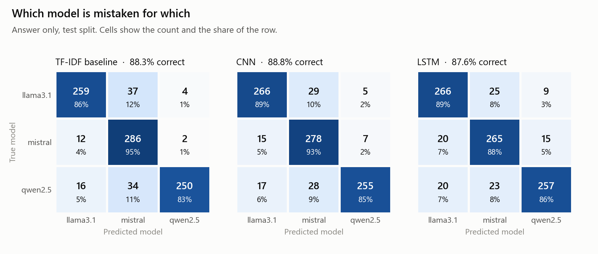
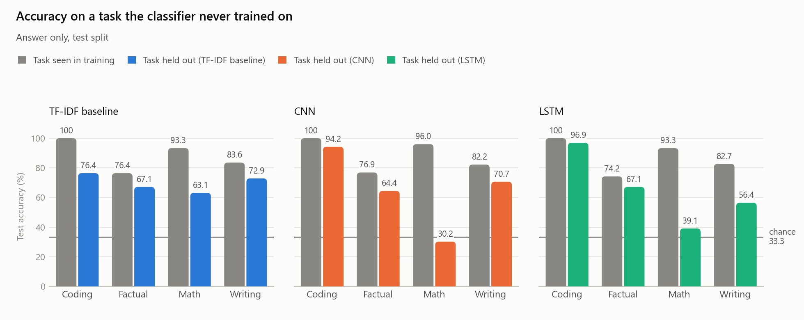
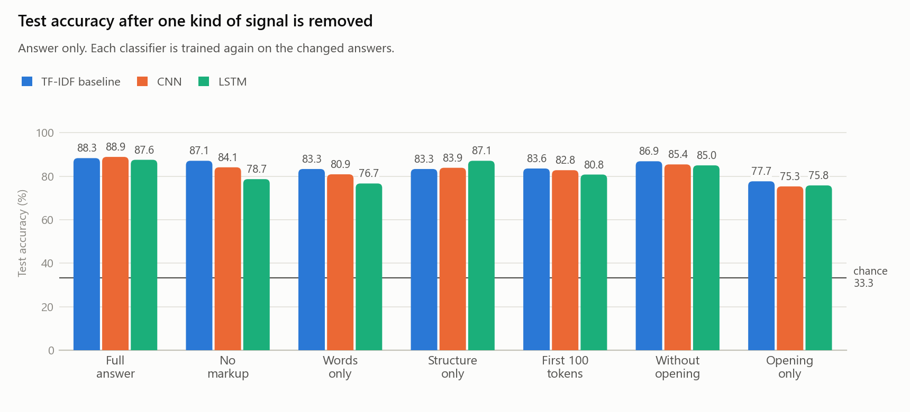
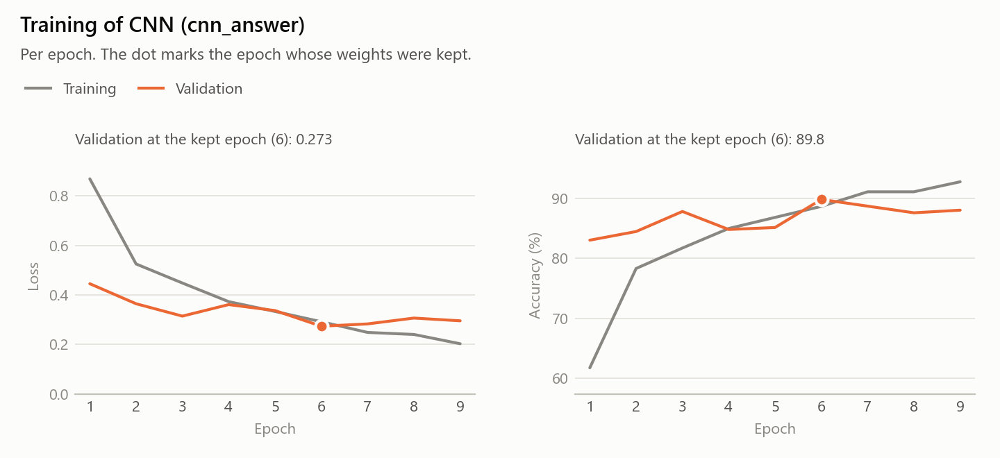
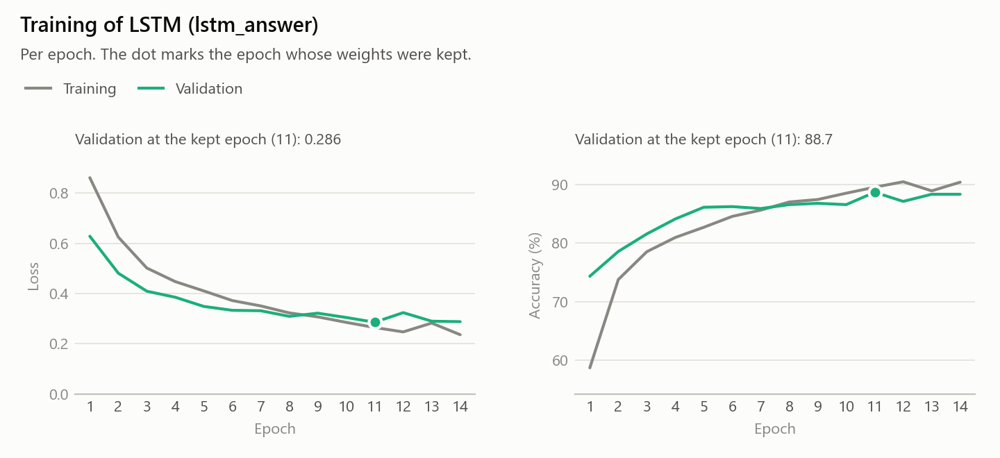

<div class="title-page">
<p class="eyebrow">CMPSC 448 | PROJECT 1</p>
<h1>Who is Writing</h1>
<p class="subtitle">Identifying Large Language Models from Their Responses</p>
<div class="title-rule"></div>
<p><strong>Team leader and sole author:</strong> Benjamin Park</p>
<p><strong>Team members:</strong> Benjamin Park (individual project)</p>
<p><strong>Submission date:</strong> 11 October 2026</p>
<p><strong>GitHub repository:</strong><br><a href="https://github.com/GraphoLogiCode/cmpsc448_project_1">github.com/GraphoLogiCode/cmpsc448_project_1</a></p>
</div>


<div class="page-break"></div>

## Abstract

This project studies multiclass source attribution: predicting which of three large language model builds generated a response. Llama 3.1 8B, Mistral 7B, and Qwen 2.5 7B each answered the same 2,000 prompts drawn from game-engine code, GSM8K, and Dolly-15k. Cleaning retained 5,994 responses from 1,998 unique prompts. A convolutional neural network (CNN), a bidirectional long short-term memory network (LSTM), and a TF-IDF logistic regression baseline were evaluated using prompt-grouped training, validation, and test splits. On 900 test responses, output-only accuracy was 88.8% for the CNN, 87.6% for the LSTM, and 88.3% for the baseline. Input-only accuracy was 33.3% for all classifiers; adding the prompt did not improve accuracy. When one task category was excluded from training, mean accuracy fell to 64.9% for both neural models and 69.9% for the baseline. Ablations showed that word choice and structural tokens each provide attribution signals. These results support attribution among the three evaluated builds within the sampled domains, but show limited transfer across domains and do not establish identification of unseen model versions.

## Table of Contents

| Section | Page |
| --- | --- |
| Title Page | 1 |
| Abstract | 2 |
| 1. Introduction and Problem Definition | 3 |
| 2. Dataset Collection and Curation | 3 |
| 3. Model Architectures | 5 |
| 4. Experimental Setup | 7 |
| 5. Results | 8 |
| 5.1 RQ1: Identifying LLMs from Responses | 8 |
| 5.2 RQ2: Does the Prompt Help? | 9 |
| 5.3 RQ3: Cross-Domain Generalization (extra credit) | 10 |
| 5.4 RQ4: Distinguishing Characteristics (extra credit) | 12 |
| 6. Discussion, Error Analysis, and Limitations | 14 |
| 7. Lessons Learned and Team Experience | 15 |
| 8. Conclusion | 16 |
| References | 17 |
| Appendix: Additional Results and Reproducibility Details | 17 |

<div class="page-break"></div>

## 1. Introduction and Problem Definition

Large language models can produce responses with recurring lexical and structural features. This project tests whether those features support **multiclass LLM-source attribution**. The task is to identify the generating model from a fixed candidate set; it does not distinguish human writing from AI-generated writing.

Given a response *y*, optionally accompanied by its prompt *x*, a classifier predicts a label *m* in {`llama3.1:8b`, `mistral:7b`, `qwen2.5:7b`}. The three experimental inputs are the prompt alone, the response alone, and the prompt followed by the response. Every classifier produces one of the three labels.

Each label represents one deployed, quantized build from a different model family. Consequently, the results concern these specific builds and generation settings. They do not establish a family-wide signature across model sizes, versions, fine-tunes, or hosting services.

| Research question | Investigation |
| --- | --- |
| RQ1: Identifying LLMs from responses | Can the CNN and LSTM identify the generator using only its response? |
| RQ2: Does the prompt help? | How do input-only, output-only, and input-plus-output results differ? |
| RQ3: Cross-domain generalization | Does a classifier trained on three task categories transfer to the fourth? |
| RQ4: Distinguishing characteristics | Which lexical and structural characteristics distinguish the generators, and what happens when signals are removed? |

RQ1 and RQ2 are the required investigations. RQ3 and RQ4 are completed extra-credit investigations. A TF-IDF logistic regression baseline provides a comparison with the required CNN and recurrent model.

## 2. Dataset Collection and Curation

### 2.1 Data sources and collection

The raw dataset contains 6,000 responses: one response from each of three LLMs to every one of 2,000 prompts. There are 500 prompts in each of four task categories. Prompt collection used seed 448. Source metadata, selection rules, attribution, and copied engine licenses are recorded in `data/prompts/SOURCES.md`.

| Task | Prompt source and selection | Recorded license |
| --- | --- | --- |
| Coding | C++ functions from Godot, OGRE, Torque3D, and Esoterica; 125 per engine, with a shared code-review instruction | MIT |
| Math | 500 sampled questions from the GSM8K test split [3] | MIT |
| Factual | Dolly-15k `open_qa` instructions with empty context, 15-300 characters [4] | CC BY-SA 3.0 |
| Writing | Dolly-15k `creative_writing` instructions with empty context, 15-600 characters [4] | CC BY-SA 3.0 |

The engine source trees were recorded on 7 October 2026; the GSM8K and Dolly source files were downloaded on 10 October 2026. Code selection excluded vendored libraries and applied copyright-header checks, with Esoterica covered by its repository license. Prompt checks reported no email addresses or phone numbers; this screening is not a comprehensive privacy audit. The provenance notes document prompt-source licenses, but the earlier collection notes do not establish a completed review of every generator's terms for redistribution of outputs.


<div class="page-break"></div>

### 2.1 Data sources and collection (continued)

Responses were generated locally with Ollama 0.32.4 [5] on an NVIDIA RTX 5090 on 10 October 2026, from 00:52 to 01:57 EDT (04:52-05:57 UTC). Collection took approximately 65 minutes. Models were processed sequentially, with up to four concurrent requests within each model's collection run.

| Label | Family / provider | Recorded size | Quantization |
| --- | --- | --- | --- |
| `llama3.1:8b` | Llama / Meta | 8.0B | Q4_K_M |
| `mistral:7b` | Mistral / Mistral AI | 7.2B | Q4_K_M |
| `qwen2.5:7b` | Qwen / Alibaba | 7.6B | Q4_K_M |

All models received the same prompt text and the explicit system prompt, "You are a helpful assistant." Temperature was 0.7, generation seed 448, context limit 4,096 tokens, and output limit 600 tokens. These limits use each generator's tokenizer. Model digests and exact settings are preserved in `data/responses/settings.json`. Shared settings reduce configuration differences, but do not make model-specific chat templates or tokenizers identical.

The collection completed with 2,000 nonempty responses per model and no reported final failed requests; the client allows up to three attempts per request. Nine responses matching a refusal pattern within their first 200 characters were retained. There were 796 responses marked `finish = "length"`: 86 Llama, 112 Mistral, and 598 Qwen responses. Their raw rates were 4.3%, 5.6%, and 29.9%, respectively. These termination flags, rather than a fresh token-count inference, define the reported generation-limit counts.

### 2.2 Dataset composition

Each record contains `llm_name`, `llm_input`, and `llm_output`, corresponding to the assignment's LLM_name, LLM_Input, and LLM_output fields. Additional metadata includes the prompt identifier, task, and generation termination status. Removing two complete prompt groups left 1,998 unique prompts and 5,994 responses.

| Family / evaluated label | Raw | Retained | Train | Validation | Test |
| --- | --- | --- | --- | --- | --- |
| Llama / `llama3.1:8b` | 2,000 | 1,998 | 1,398 | 300 | 300 |
| Mistral / `mistral:7b` | 2,000 | 1,998 | 1,398 | 300 | 300 |
| Qwen / `qwen2.5:7b` | 2,000 | 1,998 | 1,398 | 300 | 300 |
| **Total responses** | **6,000** | **5,994** | **4,194** | **900** | **900** |
| **Unique prompts** | **2,000** | **1,998** | **1,398** | **300** | **300** |

Every label covers all four task categories. Training contains 350 coding, 350 math, 349 factual, and 349 writing prompts. Validation and test each contain 75 prompts per category, with 225 responses per category. Class balance is exact within each split and task category.

### 2.3 Cleaning and preprocessing

Prompt collection checked duplicates after normalizing case and whitespace, within each engine's coding candidates or each sampled task's candidates. The recorded prompt set has no globally repeated text. Semantic near-duplicate detection was not implemented. Two prompt groups with identical cross-model answers were retained because matching responses are a legitimate source-attribution ambiguity.

Leading and trailing whitespace was stripped from every response. This changed 6 Llama, 2,000 Mistral, and 90 Qwen responses, removing Mistral's systematic leading-space artifact. Two Qwen responses contained its provider's name when their prompts did not; both complete prompt groups were removed to preserve balance. One occurrence was a self-disclosure and the other referred to an online shop. The rule therefore removes explicit label clues conservatively rather than perfectly identifying self-disclosures. No empty-output imputation was needed.


<div class="page-break"></div>

### 2.3 Cleaning and preprocessing (continued)

Markdown, code fences, punctuation, and internal whitespace were retained in the cleaned text. Formatting was retained because it is an explicit subject of RQ4. The neural tokenizer lowercases text and extracts words or individual non-whitespace punctuation characters using `\w+|[^\w\s]`. It does not encode spaces or line breaks as separate tokens. Thus, the neural models retain punctuation sequences and formatting markers, but not exact visual layout.

Each condition builds its vocabulary from training tokens after that condition's truncation. Tokens occurring fewer than twice map to `<unk>`; `<pad>` and `<sep>` are also reserved. The output-only vocabulary contains 19,928 tokens. Neural inputs are truncated to 512 tokens and padded to the longest sequence in each batch. Generator and classifier tokenization differ; 659 of 4,194 output-only training responses (15.7%) exceed the classifier limit. Section 3.3 specifies the combined-input allocation.

### 2.4 Split design and leakage prevention

Before cleaning, `assign_splits` assigns **prompt identifiers** within each task using seed 448: 350 training, 75 validation, and 75 test prompts from each original set of 500. Cleaning then removes incomplete groups without reassigning retained prompts. Both removed groups belonged to training, leaving 1,398 training, 300 validation, and 300 test groups. Their identifiers are disjoint, and all three responses to each retained prompt remain together.

Grouping prevents the same prompt from appearing in both training and evaluation. Keeping complete groups also maintains class balance. The six neural RQ1/RQ2 configurations and the baseline use the same split files. RQ3 filters these existing splits by task rather than creating new row-level splits.

Vocabulary construction, TF-IDF fitting, and feature scaling use training data only. Hyperparameters and checkpoints are selected using validation data. Each final run evaluates its selected model on the test split. The test set is reused across the reported conditions and exploratory analyses, so it should not be described as a fresh independent test for every research decision. No second confirmation dataset was collected.

## 3. Model Architectures

### 3.1 Convolutional neural network

The CNN follows the text-classification design of parallel temporal convolutions and max pooling [1]. It learns embeddings from scratch and detects local token patterns. Max pooling selects each filter's strongest activation; it does not imply invariance to changing a response's content or length.

| Component | Implementation | Output-only parameters |
| --- | --- | --- |
| Embedding | 19,928 tokens by 128 dimensions; padding index 0 | 2,550,784 |
| Convolutions | Widths 2, 3, 4, 5; 128 filters each; ReLU | 229,888 |
| Pooling | Max over time for each filter; concatenate 512 values | 0 |
| Classification | Dropout 0.5; linear projection from 512 to 3 logits | 1,539 |
| **Total** | | **2,782,211** |

Convolution positions beyond the last valid window are set to zero before max pooling. Since ReLU activations are nonnegative, those positions cannot exceed a valid activation. A sequence shorter than a kernel retains one zero-padded window for that kernel. Batches are padded to at least the widest kernel. The output is three logits; the largest determines the predicted label.


<div class="page-break"></div>

### 3.2 Recurrent neural network: bidirectional LSTM

The required RNN is a bidirectional LSTM [2], implemented in `src/models.py`. A single recurrent layer has 256 hidden units in each direction. Forward and backward outputs are concatenated at every position, and masked max pooling produces a 512-dimensional representation. The classifier uses this pooled representation rather than the final hidden state.

| Component | Implementation | Output-only parameters |
| --- | --- | --- |
| Embedding | 19,928 tokens by 128 dimensions; dropout 0.5 | 2,550,784 |
| Recurrent layer | One bidirectional LSTM, 256 units per direction | 790,528 |
| Pooling | Masked max over time of 512-dimensional outputs | 0 |
| Classification | Dropout 0.5; linear projection from 512 to 3 logits | 1,539 |
| **Total** | | **3,342,851** |

Packed sequences exclude padding from recurrent computation. After unpacking, padded positions are assigned negative infinity before max pooling. Dropout is applied to embeddings and the pooled representation; the single recurrent layer does not use an additional inter-layer dropout operation.

### 3.3 Input representations

| Condition | Text construction | Neural truncation policy |
| --- | --- | --- |
| Input only | Prompt text | First 512 tokens |
| Output only | Response text | First 512 tokens |
| Input + output | Prompt tokens, `<sep>`, response tokens | At most 170 prompt tokens, one separator, then response tokens, up to 512 total |

In the combined condition, a long prompt can displace response tokens, but cannot remove the response entirely: at least 341 token positions remain available for the response. Shorter prompts leave more space. The combined condition uses one encoder over the concatenated sequence, not separate prompt and response encoders.

Vocabularies contain 8,972 tokens for input only, 19,928 for output only, and 20,668 for combined inputs. Embedding parameter counts therefore differ across conditions even when all other layers are unchanged.

### 3.4 TF-IDF logistic regression baseline

The baseline lowercases text and uses the same word-or-punctuation token pattern. Features are token unigrams and bigrams, with minimum document frequency 2 and sublinear term frequency. A logistic regression classifier uses a maximum of 3,000 iterations. Its inverse regularization parameter C is selected on validation accuracy from {0.1, 1, 10, 100, 1000}.

Unlike the neural models, the baseline uses the full text without a 512-token limit. For combined inputs, it concatenates prompt and response with two newlines; it does not insert the neural `<sep>` token. The baseline is therefore a useful reference, but not a controlled comparison of encoder architectures under identical input budgets.


<div class="page-break"></div>

## 4. Experimental Setup

### 4.1 Training configuration

| Setting | CNN | LSTM |
| --- | --- | --- |
| Optimizer / learning rate | Adam / 0.001 | Adam / 0.001 |
| Batch size / maximum epochs | 32 / 20 | 32 / 20 |
| Loss | Multiclass cross-entropy | Multiclass cross-entropy |
| Dropout | 0.5 after pooling | 0.5 on embeddings and pooled output |
| Gradient clipping | Global norm 5 | Global norm 5 |
| Checkpoint selection | Highest validation accuracy; lower loss breaks ties | Same |
| Early stopping | 3 epochs without improving the checkpoint criterion | Same |
| Final-run seed | 448 | 448 |
| Additional validation seeds | 1, 2, 3 | 1, 2, 3 |
| Hardware | NVIDIA RTX 5090, CUDA | Same |
| Recorded PyTorch version | `2.12.0.dev20260325+cu128` | Same |

Checkpoint comparisons use the recorded rounded validation accuracy and loss. A tied accuracy with lower loss counts as an improvement and resets patience. This detail matters for input-only runs, whose accuracy remains exactly one third.

Twenty-four validation-only trials were recorded: nine CNN configurations, nine LSTM configurations, and six additional-seed runs. The CNN retained its starting configuration because observed changes were small relative to seed variation. The LSTM selected 256 hidden units and max pooling. At seed 448, increasing hidden size from 128 to 256 raised validation accuracy from 86.9% to 88.7%; using the final hidden state with 128 units scored 85.7%, compared with 86.9% for max pooling. These are modest validation gains, not established test-set improvements. The extended-patience tuning trial allowed more than 20 epochs; final runs used the limit above.

For the final output-only runs, the CNN selected epoch 6 of 9 and trained in 6.7 seconds. The LSTM selected epoch 11 of 14 and trained in 90.9 seconds. Training curves and all tuning results are provided in the appendix. The project notes record a 50-example memorization check for both models and correction of a rounding inconsistency in checkpoint selection before the final runs.

### 4.2 Evaluation protocol

All classifiers use the shared scoring function in `src/evaluate.py`. Accuracy is the fraction of correctly classified responses. For each class, precision measures correctness among predictions of that label, recall measures recovery of its true responses, and F1 is their harmonic mean. Macro-F1 averages the three class F1 scores with equal weight. Zero-division cases are assigned zero. Confusion matrices use true labels as rows and predictions as columns.

The main test set contains 900 responses from 300 prompt groups. Accuracy has a one-third reference level. The prompt-only macro-F1 need not equal one third because it depends on the distribution of predicted labels. Additional-seed runs report validation variability only; there is one saved main test run per configuration, so no test mean or standard deviation across seeds is claimed.

### 4.3 Experiment matrix

| Architecture | Input only | Output only | Input + output |
| --- | --- | --- | --- |
| CNN | Completed | Completed; RQ1 | Completed |
| LSTM | Completed | Completed; RQ1 | Completed |
| TF-IDF baseline | Completed | Completed; reference | Completed |


<div class="page-break"></div>

## 5. Results

### 5.1 RQ1: Identifying LLMs from Responses

**The evaluated model builds are distinguishable from their responses on held-out prompts from the sampled domains.** Both required neural models substantially exceed the 33.3% accuracy reference level.

| Classifier | Test accuracy | Test macro-F1 |
| --- | --- | --- |
| CNN | 88.8% | 0.8882 |
| LSTM | 87.6% | 0.8757 |
| TF-IDF baseline | 88.3% | 0.8841 |

The CNN has the highest observed accuracy: 799 of 900 responses are correct, compared with 788 for the LSTM and 795 for the baseline. Its 1.2 percentage-point advantage over the LSTM is descriptive; the saved runs do not establish a statistically reliable ranking. Validation seed variation is of comparable size.

**Per-class test performance.** Each class has 300 responses. Values below include precision, recall, and F1 rather than accuracy alone.

| Classifier | True label | Precision | Recall | F1 |
| --- | --- | --- | --- | --- |
| CNN | Llama | 0.8926 | 0.8867 | 0.8896 |
| CNN | Mistral | 0.8299 | 0.9267 | 0.8756 |
| CNN | Qwen | 0.9551 | 0.8500 | 0.8995 |
| LSTM | Llama | 0.8693 | 0.8867 | 0.8779 |
| LSTM | Mistral | 0.8466 | 0.8833 | 0.8646 |
| LSTM | Qwen | 0.9146 | 0.8567 | 0.8847 |

Qwen has the highest F1 for both neural models, while Mistral has the lowest. Qwen predictions have high precision, but some true Qwen responses are assigned to other labels. The CNN assigns 29 Llama responses and 28 Qwen responses to Mistral. This raises Mistral recall to 0.9267 while reducing its precision to 0.8299. These patterns are visible in the confusion matrices.


<p class="caption">Figure 1. Output-only test confusion matrices. Rows are true labels; columns are predicted labels. Each row contains 300 responses.</p>


<div class="page-break"></div>

### 5.1 RQ1: Performance by task (continued)

| Test task | TF-IDF baseline | CNN | LSTM |
| --- | --- | --- | --- |
| Coding | 100.0% | 100.0% | 100.0% |
| Math | 93.3% | 96.0% | 93.3% |
| Factual | 76.4% | 76.9% | 74.2% |
| Writing | 83.6% | 82.2% | 82.7% |

Each task contains 225 test responses. Code reviews are identified perfectly within this sample, while factual responses are the most difficult. This establishes variation by task, not a causal effect of task or length: prompt source, response length, and formatting also differ across categories.

The CNN and LSTM agree on 815 of 900 predictions. Both are correct on 757 responses, and both are wrong on 70. The CNN alone is correct on 42 responses and the LSTM alone on 31. The high error overlap suggests that many difficult examples are shared across architectures.

### 5.2 RQ2: Does the Prompt Help?

The six required neural comparisons use identical prompt-grouped splits. Baseline results are included as a reference.

| Classifier | Text used | Test accuracy | Test macro-F1 |
| --- | --- | --- | --- |
| CNN | Input only | 33.3% | 0.2825 |
| CNN | Output only | 88.8% | 0.8882 |
| CNN | Input + output | 87.6% | 0.8762 |
| LSTM | Input only | 33.3% | 0.2146 |
| LSTM | Output only | 87.6% | 0.8757 |
| LSTM | Input + output | 87.1% | 0.8716 |
| TF-IDF | Input only | 33.3% | 0.1667 |
| TF-IDF | Output only | 88.3% | 0.8841 |
| TF-IDF | Input + output | 87.8% | 0.8783 |

**Can input alone predict the label?** All classifiers score exactly 33.3% accuracy. Every test prompt appears with all three labels. A deterministic text-only classifier makes the same prediction for all three identical inputs and is therefore correct once per group. This is a property of the balanced dataset, not evidence that the classifier learned generator information from prompts.

**Does adding input improve over output alone?** No improvement is observed. Accuracy decreases by 1.2 percentage points for the CNN, 0.5 for the LSTM, and 0.5 for the baseline, using rounded values. For neural models, the prompt consumes part of the response token budget. That is a plausible contributor, but no controlled equal-response-budget experiment isolates the cause. A prompt may also help interpret response style conditionally even when it is marginally independent of the label; these experiments do not demonstrate such a benefit.

**What would explain unexpectedly strong input-only results?** Unequal label coverage per prompt, source-specific prompt collections, label-bearing metadata, or inconsistent evaluation could create predictability. In this dataset, complete balanced test groups mathematically fix prompt-only accuracy at one third. Prompt overlap across splits alone would not change that fact while complete groups remain balanced; nevertheless, grouping is necessary to protect response-based evaluation from prompt reuse.


<div class="page-break"></div>

### 5.3 RQ3: Cross-Domain Generalization (extra credit)

For each held-out task, all classifiers are retrained on the other three task categories. Validation also excludes the held-out category. Testing uses only that category's original 75 test prompts, giving 225 responses and 75 responses per label. The held-out category's original training and validation rows are not used.

| Held-out test task | Training and validation tasks | Train responses | Validation responses |
| --- | --- | --- | --- |
| Coding | Factual, math, writing | 3,144 | 675 |
| Factual | Coding, math, writing | 3,147 | 675 |
| Math | Coding, factual, writing | 3,144 | 675 |
| Writing | Coding, factual, math | 3,147 | 675 |

Training and validation remain exactly balanced across labels. Each neural vocabulary and each baseline feature space is refitted on the permitted training categories. Checkpoint and regularization selection use only the permitted validation categories. "Within-domain" below means performance on the same test category when all four categories were represented in training.

| Classifier | Test task | Within-domain accuracy | Cross-domain accuracy | Cross-domain macro-F1 |
| --- | --- | --- | --- | --- |
| CNN | Coding | 100.0% | 94.2% | 0.9422 |
| CNN | Factual | 76.9% | 64.4% | 0.6419 |
| CNN | Math | 96.0% | 30.2% | 0.3203 |
| CNN | Writing | 82.2% | 70.7% | 0.7047 |
| LSTM | Coding | 100.0% | 96.9% | 0.9690 |
| LSTM | Factual | 74.2% | 67.1% | 0.6556 |
| LSTM | Math | 93.3% | 39.1% | 0.3823 |
| LSTM | Writing | 82.7% | 56.4% | 0.5675 |
| TF-IDF | Coding | 100.0% | 76.4% | 0.7368 |
| TF-IDF | Factual | 76.4% | 67.1% | 0.6661 |
| TF-IDF | Math | 93.3% | 63.1% | 0.6197 |
| TF-IDF | Writing | 83.6% | 72.9% | 0.7240 |

Mean cross-domain accuracy across the four equally sized test categories is 64.9% for the CNN, 64.9% for the LSTM, and 69.9% for TF-IDF. All twelve comparisons decrease relative to their within-domain reference. Transfer is strongest for the neural models on coding, but weakest on math: the CNN reaches 30.2% and the LSTM 39.1%.

These results indicate a mixture of transferable and task-dependent signals. They do not support a uniformly reliable, domain-independent fingerprint. The comparison also changes training-set size by approximately 25%; without a matched-size control, the performance drop cannot be attributed entirely to domain shift.


<div class="page-break"></div>

### 5.3 RQ3: Per-label behavior and interpretation (continued)

The following table reports recall changes for each neural model. Each entry is within-domain recall followed by cross-domain recall on the same held-out task. Within-domain values are recomputed from the saved predictions restricted to that task; each label has 75 examples.

| Classifier | Test task | Llama recall | Mistral recall | Qwen recall |
| --- | --- | --- | --- | --- |
| CNN | Coding | 1.000 to 0.853 | 1.000 to 0.973 | 1.000 to 1.000 |
| CNN | Factual | 0.773 to 0.627 | 0.853 to 0.853 | 0.680 to 0.453 |
| CNN | Math | 0.933 to 0.427 | 0.947 to 0.173 | 1.000 to 0.307 |
| CNN | Writing | 0.840 to 0.827 | 0.907 to 0.733 | 0.720 to 0.560 |
| LSTM | Coding | 1.000 to 0.920 | 1.000 to 0.987 | 1.000 to 1.000 |
| LSTM | Factual | 0.840 to 0.693 | 0.707 to 0.933 | 0.680 to 0.387 |
| LSTM | Math | 0.867 to 0.640 | 0.933 to 0.293 | 1.000 to 0.240 |
| LSTM | Writing | 0.840 to 0.613 | 0.893 to 0.547 | 0.747 to 0.533 |

No generator is uniformly easiest across all domains. Qwen recall reaches 1.000 on held-out coding for both neural classifiers, but falls below 0.460 on factual responses and below 0.310 on math. The CNN's held-out-math confusion matrix assigns 61 of 75 Mistral responses to Llama and 42 of 75 Llama responses to Mistral; only 23 Qwen responses are correctly identified.

Task-dependent formatting is one plausible explanation. The existing analysis reports that Llama uses bold text much less often in math than overall, while Qwen's LaTeX markers are concentrated in math. A classifier trained without math may therefore encounter different feature-label relationships or previously unseen markers. This explanation remains a hypothesis: no targeted intervention established why the math confusions occurred.


<p class="caption">Figure 2. Within-domain and held-out-task accuracy. The comparison uses the same test category, but the held-out run has fewer training examples.</p>


<div class="page-break"></div>

### 5.4 RQ4: Distinguishing Characteristics (extra credit)

**Descriptive differences.** The following statistics use only the training split, with 1,398 responses per label. Token counts use the project's word-or-punctuation tokenizer rather than each LLM's generation tokenizer. Marker rates are the percentage of responses matching the corresponding detection rule.

| Characteristic | Llama | Mistral | Qwen |
| --- | --- | --- | --- |
| Mean response length, tokens | 281.4 | 265.4 | 372.7 |
| Distinct words across class | 19093 | 18862 | 20359 |
| Mean distinct tokens in first 100 | 60.6 | 61.7 | 60.3 |
| Mean sentence length, words | 20.8 | 22.6 | 17.2 |
| Responses with bold markers | 51.6% | 2.8% | 64.0% |
| Responses with heading markers | 0.8% | 0.1% | 35.0% |
| Responses with bullet lists | 25.0% | 9.7% | 52.5% |
| Responses with numbered lists | 53.0% | 52.6% | 71.2% |
| Responses with code fences | 8.1% | 0.6% | 21.3% |
| Responses with LaTeX markers | 0.9% | 0.0% | 25.8% |
| Responses with curly quotes | 0.0% | 0.1% | 22.9% |
| Responses reaching generation limit | 4.2% | 5.5% | 30.2% |

Qwen produces longer responses and more headings, code fences, LaTeX markers, and typographic quotation marks. Mistral rarely uses bold or headings; numbered lists are common for all three. The first-100-token diversity average includes only responses with at least 100 tokens: 1,220 Llama, 1,200 Mistral, and 1,315 Qwen responses. Raw vocabulary totals depend on text volume and are not a controlled lexical-diversity comparison.

**Style-feature classifiers.** Logistic regression using 16 aggregate features reaches 78.2% test accuracy and 0.7841 macro-F1. Features include length, punctuation share, word length, diversity, estimated sentence length, line frequency, markup, and punctuation rates. A `StandardScaler` fitted on training data standardizes each feature. Validation selects C from the baseline's five-value grid. Length alone reaches 37.9% accuracy and 0.3480 macro-F1, showing substantially less information in the observed runs.

Sentence length uses a heuristic split on sentence punctuation followed by whitespace. LaTeX statistics detect selected commands and delimiters; they do not parse LaTeX. Marker counts measure occurrences rather than validated rendered elements. The strongest style coefficients associate LaTeX and typographic punctuation with Qwen, and the absence of bold with Mistral. TF-IDF weights also capture recurring wording and punctuation. These linear-model associations do not directly identify features driving a particular neural prediction.

**Evidence distinction.** Descriptive statistics establish that generators differ in measured characteristics. Retraining on transformed inputs tests how much attribution remains when a signal is restricted. Neither analysis alone proves that an individual CNN or LSTM prediction depends causally on a specific feature.


<div class="page-break"></div>

### 5.4 RQ4: Signal-removal experiments (continued)

For each ablation, the transformation is applied consistently to training, validation, and test responses. Classifiers and learned preprocessing are refitted on the transformed training data. Validation retains its model-selection role. These are retraining experiments, not perturbations evaluated against a fixed original model.

| Response transformation | TF-IDF accuracy | CNN accuracy | LSTM accuracy |
| --- | --- | --- | --- |
| Full responses (separate rerun) | 88.3% | 88.9% | 87.6% |
| Selected markup removed | 87.1% | 84.1% | 78.7% |
| Words only | 83.3% | 80.9% | 76.7% |
| Words replaced with one placeholder | 83.3% | 83.9% | 87.1% |
| First 100 tokens | 83.6% | 82.8% | 80.8% |
| First 30 tokens removed | 86.9% | 85.4% | 85.0% |
| First 30 tokens only | 77.7% | 75.3% | 75.8% |

The full-response CNN ablation rerun scores 88.9%, compared with 88.8% in the main experiment, a difference of one test response. Ablation changes are compared with the full-response run in this table.

Removing selected Markdown and LaTeX markers reduces CNN accuracy by 4.8 percentage points and LSTM accuracy by 8.9 points. The implemented rule removes list and quote prefixes, LaTeX commands and delimiters, asterisks, heading symbols, and backticks. It retains underscores, dollar signs, and vertical bars, so this condition is not complete formatting removal.

Removing every non-word symbol leaves accuracies of 83.3%, 80.9%, and 76.7% for TF-IDF, CNN, and LSTM. Replacing each word with the same placeholder leaves accuracies of 83.3%, 83.9%, and 87.1%. This second condition preserves punctuation order and word counts; because tokenization ignores whitespace, it does not preserve all visual layout in the neural input.

The LSTM loses 10.9 points in the words-only condition and 0.5 points when words are replaced. This pattern is consistent with strong structural information in the task. However, retraining permits adaptation to remaining signals, so it does not quantify the original network's exclusive dependence on structure. The first 30 tokens alone achieve 75.3-77.7% accuracy, indicating that response openings contain useful information. No single tested restriction removes all attribution signal.


<p class="caption">Figure 3. Test accuracy after response transformations and retraining. The full-response reference is the separate RQ4 rerun.</p>


<div class="page-break"></div>

## 6. Discussion, Error Analysis, and Limitations

### 6.1 Representative errors

The CNN makes 101 errors: 52 factual, 40 writing, and 9 math responses; it makes no coding errors. The LSTM makes 112 errors, and 70 responses are misclassified by both models. The examples below were selected from saved output-only test predictions to illustrate recurring patterns. Excerpts are generated dataset text, not independently verified factual claims. Interpretations are hypotheses rather than feature-attribution measurements.

**Example 1: ordinary factual wording.** Prompt `factual-0142`; true label Qwen; CNN prediction Llama; LSTM prediction Llama.

> The capital of Brazil is Brasília. It was intentionally designed to be the new capital when Brazil moved from Rio de Janeiro in 1960.

This short response contains no headings, lists, or code markers. Its conventional factual wording provides few distinctive structural cues. Similar ambiguity appears in other short factual answers; the example does not demonstrate that length alone caused the error.

**Example 2: narrative style shared across generators.** Prompt `writing-0031`; true label Qwen; CNN prediction Mistral; LSTM prediction Mistral.

> Once upon a time, in a cozy little house on the edge of town, lived a kind-hearted woman named Sarah.

The conventional story opening and prose format are less distinctive than the marked-up explanatory responses common elsewhere in the dataset. Other writing responses from Llama and Qwen are also assigned to Mistral, consistent with the aggregate confusion pattern.

**Example 3: a generator uses another class's common formatting.** Prompt `writing-0409`; true label Mistral; CNN prediction Qwen; LSTM prediction Qwen.

> Escaping a labyrinth can be a challenging task, but here are some strategies that might help:
>
> 1. **Understand the layout**: Try to memorize or map out the labyrinth as you move through it.

Bold labels in a numbered explanation resemble formatting that is more frequent in Qwen responses. Mistral can also produce this format, so class-level style tendencies are not deterministic identifiers. This illustrates why descriptive correlations cannot explain every individual response.

### 6.2 Interpreting architecture differences and uncertainty

The CNN, LSTM, and baseline achieve similar overall performance. A plausible explanation is that local wording and punctuation already contain strong signals that TF-IDF captures. The results do not prove that larger models cannot improve attribution, particularly with more diverse training data.

The four validation-seed measurements have a range of approximately 1.9 percentage points for each neural architecture. The appendix reports their sample means and standard deviations. These values do not estimate test-set variability. No formal equivalence or significance test was performed, so the report treats small ranking differences as uncertain.

Responses sharing a prompt are related observations. Any future confidence interval or paired model-comparison procedure should resample or otherwise account for prompt groups. A naive independent-response interval would ignore this dependence. Cross-domain failures are substantial descriptively, but their exact magnitude combines domain changes, smaller training sets, and optimization variability.


<div class="page-break"></div>

### 6.3 Limitations and their effects on the conclusions

**Restricted candidate set.** Only three specific Q4_K_M builds were evaluated. The system always chooses one of those labels and has no unknown-model class. It cannot establish reliable identification of unseen LLMs or later versions of the same families.

**Limited prompt diversity.** The dataset contains 1,998 retained English prompts from four task categories. Coding prompts use one instruction template, and source-provided Dolly categories were not manually validated. Model separation may partly reflect these particular source and task combinations. Near-duplicate semantics were not audited.

**One generation configuration.** The models share a system prompt, temperature, and output limit, but have different tokenizers and model-specific serving templates. Only one response per model per prompt was collected. Generation reproducibility under four concurrent requests was not tested. These results cannot separate stable generator traits from effects of this sampling and serving configuration.

**Two truncation mechanisms.** The generators can stop at 600 generation tokens; the neural classifiers then retain at most 512 classifier tokens. Qwen reaches the generation cap much more often than the other models. Classification may therefore use artifacts of the collection limit, and truncated responses may hide additional signals. Combined inputs retain fewer response tokens than output-only inputs. The untruncated baseline is not an equal-budget encoder comparison.

**Residual label cues and formatting.** Cleaning removed two detected provider-name occurrences, but pattern matching does not prove the absence of all explicit clues. Internal punctuation and markup remain intentionally available. Strong accuracy therefore does not establish attribution based on semantic content or deep linguistic style alone.

**Selection and statistical scope.** Hyperparameters were selected on validation data, but exploratory comparisons repeatedly use the same test set. Main test results use one saved run per configuration. Small differences and post-hoc explanations require confirmation on new prompts, additional seeds, and ideally different generator settings.

**Cross-domain and ablation controls.** RQ3 reduces training size while changing the domain. RQ4 transformations alter several correlated properties and retrain the classifiers. These designs establish performance under the tested conditions but do not isolate every causal source of the changes.

**Reproducibility and provenance.** Run configurations, metrics, split metadata, source provenance, and generation digests are saved. Downloaded source files and trained weights are excluded from Git, and rebuilding coding prompts requires the original extraction inputs from a separate research project. Existing cleaned splits support classifier reproduction, but the repository alone is not a complete reconstruction of the original collection environment. Generator-output redistribution terms were not fully verified in the collection notes.

## 7. Lessons Learned and Team Experience

### 7.1 Dataset design and collection

The initial collection design required explicit checks on model-serving defaults. The project notes record that Qwen's packaged system prompt named its model and provider, while the other two packages did not have the same default. Applying one explicit system prompt removed that avoidable configuration difference. A token-limit trial also showed substantial truncation at 300 tokens, leading to the 600-token limit used for collection. The lesson is to inspect actual generated responses before scaling a dataset.

Raw-response inspection then revealed that every Mistral response began with a space. Stripping response boundaries removed this trivial artifact before classification. Removing entire prompt groups when one response triggered the name filter preserved the balanced design. These steps show why cleaning rules must account for the unit used in evaluation, not only individual rows.


<div class="page-break"></div>

### 7.2 Implementation and debugging

The balanced input-only experiment supplied a known accuracy of one third. The implementation notes document an early checkpoint-selection defect: rounded and unrounded validation accuracies were compared, allowing tied epochs to appear improved and extending a prompt-only run to the epoch limit. Comparing recorded values consistently corrected the issue, and the notes record that final runs and tuning were repeated. A simple invariant was more informative than a plausible-looking learning curve.

Padding required separate treatment in the two architectures. The CNN masks padded convolution positions, while the LSTM packs sequences and masks pooled outputs. The documented 50-row memorization checks supplied a basic implementation check, although successful memorization does not prove complete correctness. Recording these checks alongside the final configuration makes the reasoning behind the implementation reviewable.

### 7.3 Evaluation and research process

The TF-IDF baseline reached 88.3% test accuracy, close to both neural models. This result prevented an unsupported claim that the recurrent architecture was necessary for the task. Validation runs with different seeds also varied by nearly two points, comparable to the observed architecture gap. The resulting lesson is to compare against a simple baseline and measure run variability before interpreting small numerical gains.

The cross-domain experiments changed the interpretation of the headline result. Output-only accuracy near 88% did not imply reliable transfer: neural mean cross-domain accuracy was 64.9%, with especially weak math results. Domain-specific evaluation therefore tested a claim that the aggregate in-domain metric could not address.

The original RQ4 analysis also recorded a measurement error: a broad LaTeX rule matched dollar prices in math responses. Refining the rule reduced this false match. Feature definitions need inspection of matching examples, just as predictions need error analysis.

In a follow-up study, the next priorities would be equal-size cross-domain controls, several final test seeds, prompt-group uncertainty estimates, additional model versions, and a second evaluation dataset. A matched response-token budget would make the combined-input comparison more interpretable. These are proposed improvements, not experiments already completed.

### 7.4 Individual project experience

Benjamin Park is the sole participant and team leader. There was no division of responsibilities among multiple team members. This section reports project events supported by the saved implementation notes, source files, and experiment records; it does not attribute undocumented personal experiences. The workflow connected prompt provenance, collection checks, grouped splitting, model implementation, validation-based selection, and analysis through saved artifacts. Maintaining that connection was essential for revising the report against the actual results rather than relying on memory.

## 8. Conclusion

For RQ1, the CNN and LSTM identify the generating model on held-out prompts with 88.8% and 87.6% accuracy and macro-F1 of 0.8882 and 0.8757. The TF-IDF baseline reaches 88.3% accuracy. These results support source attribution among the three evaluated builds under the collected conditions, without establishing a reliable ranking between the classifiers.

For RQ2, input-only accuracy is exactly 33.3% by construction, and adding the prompt does not improve observed performance. For RQ3, mean cross-domain accuracy drops to 64.9% for both neural models, showing that much of the useful signal is sensitive to task distribution. For RQ4, both lexical content and structural tokens retain substantial attribution information after retraining on restricted inputs. The main limitation is scope: a balanced, fixed-candidate dataset with one generation configuration does not establish general attribution across unseen models, versions, or domains.


<div class="page-break"></div>

## References

1. Kim, Y. (2014). *Convolutional Neural Networks for Sentence Classification*. Proceedings of EMNLP, pp. 1746-1751. https://aclanthology.org/D14-1181/

2. Hochreiter, S., and Schmidhuber, J. (1997). *Long Short-Term Memory*. Neural Computation, 9(8), pp. 1735-1780. https://doi.org/10.1162/neco.1997.9.8.1735

3. Cobbe, K., et al. (2021). *Training Verifiers to Solve Math Word Problems*. arXiv:2110.14168. GSM8K source repository: https://github.com/openai/grade-school-math

4. Databricks (2023). *databricks-dolly-15k*. Dataset and documented attribution: https://huggingface.co/datasets/databricks/databricks-dolly-15k

5. Ollama. *Model library*. Evaluated tags: `llama3.1:8b`, `mistral:7b`, and `qwen2.5:7b`. https://ollama.com/library. Exact local build digests are recorded in `data/responses/settings.json`.

6. Godot Engine, OGRE, Torque3D, and Esoterica. Engine source repositories used for coding prompts: https://github.com/godotengine/godot; https://github.com/OGRECave/ogre; https://github.com/TorqueGameEngines/Torque3D; https://github.com/BobbyAnguelov/Esoterica. Recorded commits: `3ea0cf3e`, `b74c0615`, `4c44642a`, and `10f3f616`, respectively. Prompt-level origins and license copies are recorded in `data/prompts/`.

7. Project experiment artifacts (2026). `data/splits/split_report.json`; `data/responses/settings.json`; `results/baseline.json`; `results/runs/*/metrics.json`; saved test predictions; `results/tuning.jsonl`; and `results/rq4.json`. Repository: https://github.com/GraphoLogiCode/cmpsc448_project_1

## Appendix: Additional Results and Reproducibility Details

### A. Run inventory and configuration

The table below identifies all six main neural runs. All use the shared training settings in Section 4.1 and the architectures in Sections 3.1-3.2. Parameter differences arise from vocabulary size. Time refers to the recorded training interval, not data collection or complete pipeline runtime.

| Run | Vocabulary | Parameters | Best / total epochs | Seconds |
| --- | --- | --- | --- | --- |
| cnn_prompt | 8,972 | 1,379,843 | 9 / 12 | 8.4 |
| cnn_answer | 19,928 | 2,782,211 | 6 / 9 | 6.7 |
| cnn_both | 20,668 | 2,876,931 | 12 / 15 | 9.8 |
| lstm_prompt | 8,972 | 1,940,483 | 2 / 5 | 24.7 |
| lstm_answer | 19,928 | 3,342,851 | 11 / 14 | 90.9 |
| lstm_both | 20,668 | 3,437,571 | 11 / 14 | 87.3 |

Baseline C values are 0.1 for input only, 100 for output only, and 1000 for combined input. Its unigrams and bigrams use minimum document frequency 2, sublinear term frequency, and default TF-IDF normalization. Neural vocabularies use minimum token count 2. Python and library dependencies are listed in `requirements.txt`; the file is not a complete version-pinned environment lock.

Generation metadata records temperature 0.7, seed 448, context 4,096, output limit 600, four workers, and the common system prompt. Raw dataset records are preserved in `data/responses/`; cleaned files and their split report are in `data/splits/`.


<div class="page-break"></div>

### B. Hyperparameter search and validation-seed results

The first 18 trials are one-factor configuration comparisons using seed 448. The LSTM starting point uses 128 hidden units; final LSTM seed comparisons use 256. Tuning selects by validation metrics. Its shared loader also reads the test file, but tuning neither evaluates that loader nor uses its contents to fit the vocabulary or select settings.

| CNN setting | Validation accuracy | LSTM setting | Validation accuracy |
| --- | --- | --- | --- |
| starting point | 89.9% | starting point | 86.9% |
| 700 tokens | 89.4% | last memory instead of max | 85.7% |
| widths 1 to 5 | 88.9% | 700 tokens | 84.6% |
| widths 3 to 5 | 89.7% | 256 units | 88.7% |
| 256 filters | 89.8% | 2 layers | 87.8% |
| embedding 256 | 89.3% | dropout 0.3 | 87.2% |
| dropout 0.3 | 89.9% | learning rate 0.002 | 87.9% |
| learning rate 0.0005 | 90.2% | embedding 256 | 86.3% |
| batch 64 | 89.1% | patience 5 | 87.6% |

| Seed / summary | CNN validation accuracy | LSTM validation accuracy |
| --- | --- | --- |
| 448 | 89.9% | 88.7% |
| 1 | 88.0% | 86.8% |
| 2 | 88.3% | 88.7% |
| 3 | 89.1% | 87.4% |
| Mean +/- sample SD | 88.83% +/- 0.84 pp | 87.89% +/- 0.94 pp |

The sample standard deviation uses denominator n-1 across four runs. These values are computed from the stored, rounded validation accuracies. The tuning CNN's seed-448 accuracy is 89.9%; the separate main CNN run records 89.8%. The project did not enforce fully deterministic GPU operations, so a fixed seed does not guarantee identical results. No mean or standard deviation of test accuracy across seeds is available.

### C. Baseline per-class performance

Output-only baseline precision, recall, and F1 on the 900-response test set:

| Label | Precision | Recall | F1 |
| --- | --- | --- | --- |
| Llama | 0.9024 | 0.8633 | 0.8825 |
| Mistral | 0.8011 | 0.9533 | 0.8706 |
| Qwen | 0.9766 | 0.8333 | 0.8993 |


### C.1 Report criterion mapping

| Report criterion | Evidence location |
| --- | --- |
| Problem definition and dataset curation | Sections 1-2 |
| CNN/RNN implementation and training | Sections 3-4; Appendix A-B |
| Results and presentation | Section 5 |
| In-depth analyses and experiments | Sections 5.3-5.4 and 6 |
| Lessons and experience | Section 7 |

<div class="page-break"></div>

### D. Training curves and additional figures

The selected checkpoint is marked in each curve. Training metrics average batches scored as weights change during the epoch, with dropout enabled. Validation scores the current end-of-epoch weights with dropout disabled. The best checkpoint is subsequently restored for final evaluation. Early validation accuracy can therefore exceed the training average without implying leakage.


<p class="caption">Figure A1. CNN output-only training history; epoch 6 is selected.</p>


<p class="caption">Figure A2. LSTM output-only training history; epoch 11 is selected.</p>

The CNN's training loss continues to decrease after its selected checkpoint while validation loss worsens, consistent with overfitting. The LSTM improves more gradually. Additional figures for input comparisons, per-task accuracy, and all saved training histories are in `results/figures/`.


<div class="page-break"></div>

### E. Reproduction commands

Run commands from the repository root after installing the Python dependencies and a compatible PyTorch build. The existing cleaned splits allow classifier experiments without regenerating LLM responses. Retraining overwrites the corresponding saved run outputs, and exact GPU results may vary.

**Data collection and preparation** (requires Ollama, the three model builds, downloaded prompt sources, and the original coding extraction inputs):

```text
ollama pull llama3.1:8b
ollama pull mistral:7b
ollama pull qwen2.5:7b
python src/collect_prompts.py
python src/generate_responses.py
python src/check_responses.py
python src/build_dataset.py
```

**Required experiments and validation search:**

```text
python src/baseline.py
python src/tune.py
python src/train.py --model cnn --mode prompt
python src/train.py --model cnn --mode answer
python src/train.py --model cnn --mode both
python src/train.py --model lstm --mode prompt
python src/train.py --model lstm --mode answer
python src/train.py --model lstm --mode both
```

**Cross-domain runs:** repeat the following three commands with each of `coding`, `factual`, `math`, and `writing` as the held-out argument.

```text
python src/baseline.py --held-out coding
python src/train.py --model cnn --held-out coding
python src/train.py --model lstm --held-out coding
```

**Signal analysis, tables, figures, and PDF:**

```text
python src/rq4.py
python src/evaluate.py
python src/plot_results.py
python report/build_pdf.py
```

The PDF builder requires `mistune` and Chrome or Edge. Main-run configuration, history, metrics, and predictions are stored under `results/runs/<run>/`. RQ4 statistics and ablation metrics are in `results/rq4.json`. Trained weights are written under `models/` but excluded from Git. Source hashes, code-source revisions, model digests, and split seed provide the available provenance record; they do not guarantee regeneration under changed software or hardware.

<div class="page-break"></div>

### F. Implementation trace and verification

The technical descriptions above were checked against the executing functions, saved configurations, and model weights. The following map identifies the implementation behind the main report claims.

| Stage | Implementing functions | Behavior relevant to the report |
| --- | --- | --- |
| Collection | `generate_responses.ask`, `run_model` | Sends system and user messages to Ollama; retries requests; appends completed responses and skips saved prompt IDs on resume |
| Cleaning and split | `build_dataset.assign_splits`, `names_itself` | Assigns original prompt groups before cleaning; removes incomplete groups without reshuffling |
| Neural inputs | `data.row_tokens`, `Vocabulary`, `collate` | Constructs and truncates condition-specific tokens; fits training vocabulary; returns token IDs, true lengths, and class indices |
| CNN | `TextCNN.forward` | Embeds tokens, runs four convolution banks, applies ReLU and window masks, then max-pools and classifies |
| LSTM | `LSTMClassifier.forward` | Applies embedding dropout, packs sequences, runs the bidirectional LSTM, masks padding, max-pools, and classifies |
| Training | `train.run_epoch`, `fit` | Backpropagates cross-entropy; clips gradients; selects by rounded validation accuracy and loss; restores saved best weights |
| Evaluation | `evaluate.predict`, `score` | Disables dropout and gradients for inference; takes the largest logit; computes common metrics in fixed label order |
| Signal analysis | `rq4.style_by_model`, `feature_classifiers`, `ablation` | Computes statistics, fits standardized style features, and retrains classifiers on consistently transformed responses |

For a batch of B sequences padded to T tokens, the CNN transforms IDs of shape B by T into embeddings B by T by 128, then transposes them to B by 128 by T for `Conv1d`. Each kernel produces 128 filter responses; temporal pooling and concatenation give B by 512, and the linear head gives B by 3. The LSTM starts with the same embedding shape and produces B by T by 512 after unpacking its two directions. Masked pooling also gives B by 512 before its three-logit head.

Implementation checks reproduced every one of the 5,994 cleaned records from raw responses and reproduced the recorded RQ4 descriptive statistics. Forward-pass checks verified finite three-logit outputs and consistent predictions when short sequences were evaluated alone or beside longer padded sequences. Reloading all 14 saved neural checkpoints reproduced every saved test prediction and every stored test metric, including held-out-task runs. Their vocabulary sizes, parameter totals, and selected epochs also matched the saved configurations.

These checks verify the current code and local artifacts; historical debugging and collection decisions are supported by project notes. The checks can be repeated with `python report/verify_implementation.py`. They require the local weight files, which are excluded from Git. They run inference and reconstruction without retraining or overwriting experiment results.
